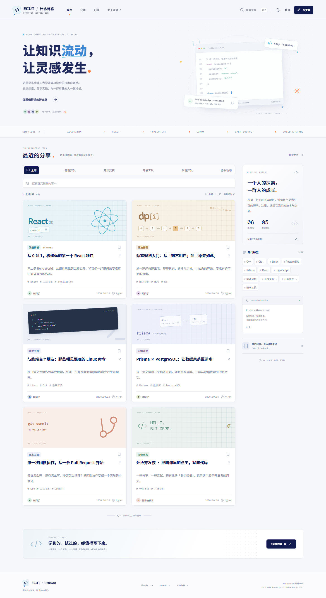
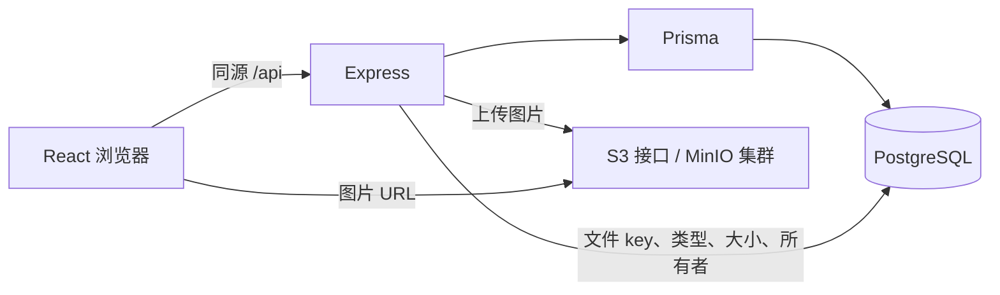

# ECUT · 计协博客

面向东华理工大学计算机协会的技术博客。使用 **React + Express + Prisma + PostgreSQL**，图片存入独立的 S3 兼容对象存储。目录按 `fd / bd / db` 拆分。

视觉参考用户提供的[协会落地页 feat-reconstruct-lxw 分支](https://github.com/DL-Association-for-Computing-Machinery/association-website/tree/feat-reconstruct-lxw)：浅色点阵纸面、海军蓝标题、青蓝色强调、橙色点缀、终端与代码元素。这里重新设计了适合阅读的博客布局，插画由 CSS / SVG 构成。页面字体随应用自托管，无需访问外部字体服务。

## 已实现

- 首页文章流、五个分类、标签筛选、搜索、时间排序、分页、归档、协会介绍。
- Markdown / GFM 阅读，代码块、目录、封面、阅读时间、链接分享。
- 注册、登录、退出；作者维护自己的文章，管理员可管理文章和评论。
- 写作、预览、本机自动草稿、服务器草稿、发布、编辑、删除。
- 评论、回复、分页和作者删除；文章删除时级联删除评论。
- 封面和正文图片上传；PNG / JPEG / WebP，最大 8 MB，检查文件头。
- 本机收藏、深浅主题、键盘搜索、移动端单列阅读、减少动画偏好。

首页自带 6 篇原创示例文章和虚构示例作者，便于演示。活动文章明确标注为示例。正式运营时请替换为协会实际内容。示例作者使用随机密码，没有通用默认登录密码；可以直接注册自己的账号。



另见 [深色模式](docs/previews/home-dark.png)、[手机首页](docs/previews/home-mobile.png)、[文章页](docs/previews/article-desktop.png)。

## 目录

```text
fd/                 React 19 + Vite + TypeScript
  src/              页面、组件、样式、API 调用
bd/                 Express 5 + TypeScript
  src/              路由、认证、权限、对象存储上传
  prisma/           Schema、迁移、示例数据和种子脚本
  test/             密码和文件校验测试
db/
  compose.yaml              PostgreSQL + 单节点 MinIO 开发环境
  compose.distributed.yaml  四节点、八数据卷 MinIO 配置
  storage-nginx.conf        分布式存储统一入口
  dev-services.mjs          无 Docker 时的本地联调工具
tests/              Playwright 浏览器和真实 API 集成测试
docs/previews/      实际运行截图
```

## 启动

要求 Node.js 22.12+、npm；标准开发环境还需要启动 Docker Engine。以下命令从项目根目录执行，文件复制命令使用 Git Bash；PowerShell 可用 `Copy-Item bd/.env.example bd/.env`。

首次配置：

```bash
npm ci
cp bd/.env.example bd/.env
docker compose -f db/compose.yaml up -d
npm run db:generate
npm run db:migrate
npm run db:seed
npm run dev
```

已有 `bd/.env` 时保留自己的配置。等待 PostgreSQL 就绪、`storage-init` 成功退出后再上传图片。

- 网页：<http://localhost:5173>
- API 健康检查：<http://localhost:4000/api/health>
- MinIO 控制台：<http://localhost:9001>（开发凭据见 `.env.example`）

Vite 将 `/api` 代理到 4000 端口。开发环境支持 `localhost:5173`、`127.0.0.1:5173` 和内网 IP 的 5173 端口；生产环境只接受 `WEB_ORIGIN` 指定的来源。如果更改 API 端口，需要同步修改 `fd/vite.config.ts`。仅运行前端时会标注“示例预览”，可体验阅读和本机草稿；注册、评论、上传和发布需要后端在线。

### 没有启动 Docker 时

提供了本地 PostgreSQL 17 和 S3rver 协议模拟器，用于开发联调。**S3rver 不是分布式存储，也不用于生产部署。** 与 Docker 方式二选一，避免端口冲突。

```bash
# 完成 npm ci 与 bd/.env 配置后，在第一个终端保持运行
npm run dev:services

# 在第二个终端执行
npm run db:generate
npm run db:migrate
npm run db:seed
npm run dev
```

这台 Windows 机器的 5432 端口无法绑定，当前本地 `.env` 使用 `127.0.0.1:55432`；工具会自动读取该端口。其他机器遇到相同情况也可在 `DATABASE_URL` 中指定一个空闲端口。

为兼容 Windows 中文项目路径，本地工具将 PostgreSQL 运行文件和数据库放到系统临时目录中的 `ecut-*` 子目录，启动时输出准确路径；模拟对象存放在项目 `.local/media`。这些数据仅用于开发，可被系统临时文件清理影响。需要长期保存的数据请使用 Docker 数据卷或独立 PostgreSQL。停止工具使用所在终端的 Ctrl+C。

## 数据与分布式文件存储



关系模型使用独立的 User、Session、Post、Category、Tag、PostTag、Comment、Asset 表。文章和标签通过联合主键关联；评论有父评论关系；文章状态、发布时间、作者、分类、评论时间等查询字段建立索引。数据库迁移已经随代码提供。

PostgreSQL 不保存图片字节或 Base64 图片。`Asset` 只记录对象 key、大小、MIME 和所有者；封面通过 `coverId` 关联，Markdown 正文使用存储服务提供的 URL。上传成功但数据库写入失败时会尝试删除刚上传的对象。

### 分布式模式

需要 Docker Engine 在线。先停止单节点 MinIO / 本地 S3 模拟器，再启动独立集群：

```bash
docker compose -f db/compose.yaml up -d postgres
docker compose -f db/compose.distributed.yaml up -d
```

这是 **4 个 MinIO 节点 × 2 个数据卷**，通过 Nginx 暴露统一的 9000 端口，应用层无需修改上传代码。该文件用于验证分布式模式；同一宿主机上的多个容器不具备跨主机容灾能力。正式部署需将节点和数据盘分散到独立机器，或接入已有 S3 兼容集群，并配置 TLS、备份及监控。

两种 MinIO 配置的 bucket 都为 `blog-media`，初始化为公开下载，适合公开博客图片。未发布文章的图片也可能通过 URL 访问；当前实现不提供私密附件权限。删除文章不会自动删除图片，以免破坏被其他 Markdown 文章引用的资源。

环境变量职责：

| 变量                              | 用途                                           |
| --------------------------------- | ---------------------------------------------- |
| `DATABASE_URL`                    | PostgreSQL 连接，密码含特殊字符时需 URL 编码   |
| `WEB_ORIGIN`                      | 正式站点的可信来源，用于 CORS 和写请求来源校验 |
| `S3_ENDPOINT`                     | 后端连接的存储接口，可用内网地址               |
| `S3_BUCKET` / `S3_REGION`         | 存储桶与区域                                   |
| `S3_ACCESS_KEY` / `S3_SECRET_KEY` | 仅保存在后端的上传凭据                         |
| `S3_PUBLIC_URL`                   | 浏览器可访问的桶地址或 CDN 地址，无末尾斜杠    |
| `NODE_ENV`                        | 生产设置 `production`，会启用 Secure Cookie    |

生产应使用仅对博客桶授权的应用凭据。Compose 的变量来自 shell 或显式传入的 `--env-file`，不会自动读取 `bd/.env`；更改开发凭据时，可使用 `docker compose --env-file bd/.env -f db/compose.yaml up -d` 同步配置。

## 管理账号与内容

需要管理员时，在后端环境中设置 `SEED_ADMIN_EMAIL`、`SEED_ADMIN_PASSWORD`（至少 12 位），执行 `npm run db:seed`。若邮箱已存在，脚本提升角色并保留原密码；不会重置现有账号密码。初始化完成后移除种子密码配置。

当前开放注册，成员可以发布自己的文章。分类初始为前端开发、算法竞赛、开发工具、后端开发、协会动态，可在种子数据或数据库中维护；标签在写作时自动关联 / 创建，英文大小写统一匹配。当前未包含独立的分类后台、邮箱验证、找回密码及审核工作流。

账号密码采用带独立盐的 scrypt；会话令牌以哈希保存，Cookie 为 HttpOnly / SameSite，默认 7 天有效。写操作校验网页 Origin、输入和作者权限，认证与内容写入有速率限制。Markdown 不执行原始 HTML。

## 验证与构建

```bash
npm run check
npm test
npm run build

# 保持开发服务和数据库运行，用初始 6 篇示例数据验证
npm run test:e2e
```

浏览器测试默认使用本机 Microsoft Edge。没有 Edge 的环境可安装 Chromium，并在 Git Bash 执行：

```bash
npx playwright install chromium
PW_CHANNEL=chromium npm run test:e2e
```

测试包括筛选搜索、收藏、主题持久化、手机布局、实际注册和写作、编辑恢复、权限隔离、评论回复、伪造文件拒绝、图片存储和读取。集成测试会创建测试账号与图片，并删除其测试文章；请只对开发数据库运行。写入限流为每分钟 12 次，连续重跑遇到 429 时等待窗口结束即可。

本机已实际验证 PostgreSQL 迁移与种子、S3rver 上传读取，以及桌面和手机页面；Docker Engine 未启动，因此 MinIO 两套配置仅完成 Compose 静态校验，未验证集群运行或节点故障切换。

部署时，前端构建产物为 `fd/dist`，后端入口为 `bd/dist/src/index.js`。在 `bd` 工作目录执行 `npm start`；先注入生产环境变量并运行迁移。网站反向代理应将 `/api` 转发到 Express，其余路径通过 `try_files $uri /index.html` 支持 React Router 刷新；域名通过 HTTPS 访问。示例内容与管理员种子按需初始化，生产迁移不会自动插入示例。
